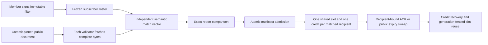

# SemanticFanoutBuffer

Experimental GenLayer **credit-controlled multicast**, not a graph updater, proof generator, escrow or certificate issuer. Full public documents are independently acquired and semantically evaluated against subscriber-authored filters. The resulting vector determines actual shared-buffer occupancy and per-recipient outstanding credits.

## Problem and why GenLayer

A single-worker queue hands one job to one worker. A multicast broker must retain one message until **every intended recipient** acknowledges or its retention deadline expires. Slow recipients need bounded outstanding credits; they must not prevent unrelated traffic from reaching ready recipients.

Ordinary contracts can maintain counters but cannot reliably interpret prose against independently chosen subscription predicates, including negation and exceptions. Here GenLayer validators independently fetch complete committed bytes and derive the entire match vector. A wrong vector would consume the wrong members' credits and alter retention. AI is consequential, not a decorative opinion about a deterministic transition.

## Architecture



The external source owns authored text, not verified reality. The contract owns acquisition, source binding, independent match evaluation and resource bookkeeping. ACK is an onchain acknowledgement only—not proof that software processed a document or delivered a real service. All data is public. The fictional notices demonstrate document routing, not actual maintenance or price changes.

## Distinct mechanism

This is **one representative multicast/backpressure mechanism**, not parallel domain variants. Compared with the existing SemanticWorkQueue, a packet has multiple independently authenticated pending recipients, a shared retained slot, all-or-nothing fanout admission and per-subscriber flow control. There is no single-worker lease winner, FIFO lane head or worker redelivery. Compared with LicenseObligationPool, membership is not a reversible obligation checklist: actual bounded buffer slots are held and fenced across reuse. Compared with AffineInvariantForge, there is no AI theorem synthesis or algebraic certificate. No owner can edit a graph, choose a consensus result, consume a capability or unilaterally release another member's acknowledgement.

Multicast, credits and generation fencing are established systems concepts. The repository does not claim global novelty, reviewer acceptance or an independent audit. Transport/signing helpers are shared infrastructure; the broker protocol is the business mechanism.

## State and consensus

```mermaid
stateDiagram-v2
 [*] --> ENROLLING
 ENROLLING --> ACTIVE: every listed member signs a filter; anyone activates
 ENROLLING --> ABORTED: missing subscriptions after enrollment deadline
 ACTIVE --> PUBLISHED: every matching member has credit and a slot is free
 ACTIVE --> BACKPRESSURED: credit or physical capacity unavailable
 ACTIVE --> UNRESOLVED: any match is UNKNOWN
 ACTIVE --> NO_MATCH: all matches are NO
 ACTIVE --> HELD: evidence acquisition or commitment fails
 PUBLISHED --> DRAINED: all intended members ACK
 PUBLISHED --> EXPIRED: public sweep at retention deadline
```



Packet outcome records are immutable. Delivery bookkeeping is separate: `ACTIVE` tracks pending recipients, `DRAINED` records their ACKs and `EXPIRED` records who did not ACK. Packet histories remain available after a slot is released. There is no certificate consumption API.

Every nondeterministic execution fetches a contract-constructed `https://raw.githubusercontent.com/OWNER/REPO/FULL_COMMIT/PATH.txt` URL, verifies HTTP status, complete UTF-8 body size (1–4096 bytes), raw SHA-256 and commitment. No truncated or lossy-decoded input is classified. Each validator independently reasons over the complete body and every signed filter, then compares the **entire** canonical report: binding, acquired bytes/status/hash and ordered YES/NO/UNKNOWN vector. No confidence or threshold tolerance exists. Malformed output or consensus disagreement commits nothing; it is not fabricated as a successful `CONFLICTED` result.

Any UNKNOWN blocks the entire fanout, including definite matches, rather than silently dropping a possibly intended recipient. Acquisition failure yields HELD with no model vector. BACKPRESSURED, HELD, UNRESOLVED and NO_MATCH attempts reserve no slot and no subscriber credit. Their nonce cannot be reused; a distinct publication can retry later with a fresh nonce. Re-publishing the same document under a new nonce is allowed and visible; no semantic exactly-once guarantee is claimed.

## Credit, capacity and liveness rules

- Fixed 2–4-member roster. Each listed address signs its own immutable predicate before activation. The creator cannot choose another member's filter.
- One packet occupies one physical slot regardless of how many recipients matched. Each pending recipient consumes one of its own 1–2 configured credits.
- Admission is atomic: all matched members must have credit and one of 1–4 slots must be free. A busy **nonmatching** member does not block a packet for ready matching recipients.
- Only the authenticated pending subscriber can ACK its own obligation. Root, channel, packet ID and generation are checked. Knowing a public token/root is not authority.
- A partial ACK returns that member's credit but retains the shared slot for remaining recipients. Duplicate ACKs cannot release credit twice.
- At the 60–3600-second retention deadline, ACKs reject. Anyone can sweep remaining obligations, return their credits exactly once and release the slot. New publications also sweep expired slots atomically.
- Reusing a slot increments its generation. An old packet/ACK cannot affect its replacement.
- Anyone can activate a fully subscribed channel; an incomplete one can be aborted after one hour. No funds or locked monetary balances exist.
- At most 24 publication attempts per channel and 8 channel creations per creator. Budget exhaustion does not disable ACK or sweep. Enrolled members can exhaust the shared publication budget; this is not Byzantine fair scheduling or Sybil resistance.

For each member, `outstanding == number of ACTIVE delivery records whose pending set contains that member`. Pending, acknowledged and expired recipient sets form a disjoint partition of the immutable intended audience. The independent JavaScript checker verifies those conservation rules and reconstructs admission from each packet's recorded credit snapshot.

## Example workflow

The demo's two signed filters select (A) definite planned-maintenance service-unavailability statements and (B) definite subscription price increases, even in fictional authored notices.

1. A shared notice matches both: one slot, two credits reserved.
2. A ACKs: A's credit returns, B still holds the shared slot.
3. A second shared notice is BACKPRESSURED by B even though another slot is free.
4. A maintenance-only notice, explicitly stating **no price increase**, matches only A and can use that free slot.
5. Independent ACKs drain both messages. A new shared publication reuses the first slot with a higher generation; a stale ACK rejects.
6. A wrong-hash publication creates no delivery. A separate short-retention channel demonstrates public expiry recovery without subscriber cooperation.

The contract evaluates the actual fetched text, not caller-provided labels or summaries. The notice authorship and SHA commitment do not prove real-world service facts. Source pinning fixes a revision, not its present-day applicability. Message TTL is broker retention, not a fact-freshness oracle.

## Install and test

```powershell
python -m venv .venv
.venv\Scripts\pip install -r requirements-dev.txt
npm ci --ignore-scripts
.venv\Scripts\genvm-lint check contracts/SemanticFanoutBuffer.py --json
.venv\Scripts\python -m pytest tests -q
npm run test:unit
npm run test:sdk
```

33 Python tests, 4 independent JavaScript tests and 13 SDK calldata roundtrips. Tests cover multicast retention, partial/double ACKs, capacity versus credit blocking, 3,888 four-member filter/credit combinations, unknown/no-match propagation, source/hash/size/encoding failures, independent validator refetch and reasoning, forged reports, immutable context snapshots, slot fencing, foreign/cross-channel ACKs, root mismatch, enrollment abort and credit recovery after the attempt budget is exhausted. Direct-mode tests run only the leader; explicit callback tests are not distributed consensus. The Windows fixture narrowly defers gltest's open-tempfile unlink only.

## Deploy and interact

```powershell
npm install -g genlayer@0.39.2
genlayer network set studionet
genlayer account create --name fanout-test
genlayer account use fanout-test
genlayer account unlock
genlayer deploy --contract contracts/SemanticFanoutBuffer.py
genlayer schema CONTRACT_ADDRESS
```

StudioNet is the gasless test environment. No funding or value transfer is required. Use a dedicated encrypted native keystore and OS-vault signing; do not export keys or paste passwords into chat/source. The sanitized wrapper selects `FANOUT_TEST_ACCOUNT` process-locally without changing the global network/account. Set `FANOUT_CLI_PATH` to the CLI entrypoint outside this development workspace.

Public APIs: `open_channel`, `subscribe`, `activate`, `abort_unenrolled`, `publish`, `ack`, `sweep`; views: `get_channel`, `get_packet`, `get_delivery`, `mailbox`, `get_transition`, `transition_count`. Addresses/rosters and source coordinates are strings; no nested JSON CLI arguments are needed. Subscription enrollment and ACK must be signed by the actual member.

`node scripts/complete-proofs.mjs FIXTURE_COMMIT` executes the documented demo with dedicated native test signers and writes `PROOFS.json` before each broadcast. Known hashes resume with read-only receipt checks; unknown outcomes stop for inspection instead of blind resubmission. Serial writes respect Studio rate limits. `node scripts/verify-live.mjs` signs/sends nothing: it checks finalized execution outcomes, source equality, every packet root and delivery credit partition, and retained failure distinctions. The read adapter uses SDK-encoded raw calldata for Studio's long-argument read compatibility; it permits read-mode `gen_call` only.

Finalization alone does not establish success. Require execution SUCCESS, MAJORITY_AGREE, actual state readback and matching deployed source. Expected ERROR guard receipts are rejection evidence, not successful deliveries. [LIVE_PROOFS.md](LIVE_PROOFS.md) records only verified real transactions; [SUBMISSION.md](SUBMISSION.md) contains portal text when generated. [SECURITY.md](SECURITY.md) states the trust boundary and limitations.
